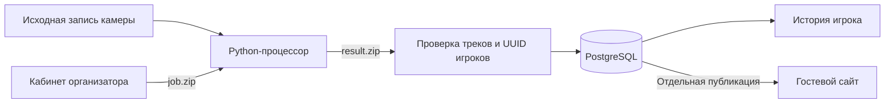

# AI Football

Сервис для организации футзальных турниров и анализа записей матчей со статичной камеры.

[](https://github.com/TimPad/AI-football/actions/workflows/ci.yml)

**Текущая поставка:** локальный кабинет организатора, гостевой сайт и внешний импорт видеоаналитики. Оператор обрабатывает исходное видео отдельно, проверяет соответствие треков игрокам и публикует выбранный результат. Счёт, голы и карточки ведутся в ручном протоколе.

## Возможности

- **Турниры и расписание:** версии регламентов, заявки, составы, календарь и места проведения.
- **Команды и игроки:** единая форма команды с логотипом и составом, фото и основные параметры игроков; стабильные UUID людей.
- **Залы и камера:** вручную введённые адрес и размеры поля, контрольные точки, гомография и версии калибровки; снимок геометрии матча. Яндекс Карты служат навигации.
- **Протокол:** ручные события и часы, подтверждение, история изменений, отдельная публикация; сохранение ввода и безопасные повторы запросов.
- **Сайт зрителя:** матчи, расписание, опубликованные протоколы, ссылки и встраиваемый плеер ВК.
- **Видеоаналитика:** задание ZIP, локальный Python-процессор, проверка пакета, миниатюры и ручное назначение треков людям, метрики/карты, история игроков и независимая публичная версия.

## Архитектура



В первой поставке видео остаётся у оператора. На сервер возвращаются JSON, интервалы, проверки качества и миниатюры. Приватные пакеты и вложения хранятся отдельно от Git и входят в резервную копию.

**Стек:** Python 3.12+, FastAPI, SQLAlchemy/Alembic, PostgreSQL 16, Polars/OpenCV/Ultralytics, React 19, TypeScript, Vite, Vitest и Playwright. Python-зависимости зафиксированы в `uv.lock`, frontend — в `web/package-lock.json`.

## Локальный запуск

Потребуются Python 3.12, `uv`, Node.js 24 и работающий Docker с Compose. Команды выполняются из корня проекта.

```sh
git clone https://github.com/TimPad/AI-football.git
cd AI-football
uv sync --locked --all-extras
npm --prefix web ci
cp .env.example .env
```

Заполните в `.env` `PGPASSWORD` и тот же пароль в `DATABASE_URL` вместо `CHANGE_ME`. При специальных символах пароль в URL должен быть URL-encoded. `.env` не добавляется в Git.

```sh
chmod 600 .env
docker compose up -d db
.venv/bin/python -m alembic upgrade head
.venv/bin/python -m aifootball.service.auth.cli create-admin --login admin
npm --prefix web run build
.venv/bin/python -m uvicorn aifootball.service.app:create_app --factory --host 127.0.0.1 --port 8000
```

Создание администратора запрашивает пароль интерактивно; этот шаг выполняется один раз для новой базы. При обновлении существующей установки повторно примените миграции и соберите frontend, сохранив базу и папку вложений.

- Гостевой сайт: <http://127.0.0.1:8000/>
- Кабинет: <http://127.0.0.1:8000/login>
- OpenAPI: <http://127.0.0.1:8000/docs>
- Готовность: <http://127.0.0.1:8000/api/v1/ready>

Для разработки интерфейса: `npm --prefix web run dev` в отдельном терминале при работающем API. За деталями конфигурации и восстановления см. [инструкцию сервиса](docs/service-stage1.md).

## Обработка видео

1. Сохраните составы обеих команд, зал и калиброванный профиль камеры в матче.
2. Админ+ открывает «Видео и аналитика», создаёт задание и скачивает `job.zip`.
3. Поместите доверенные веса `yolo11m.pt` в локальную папку `models/`. Веса и исходное видео не входят в репозиторий.
4. На компьютере с записью запустите:

```sh
.venv/bin/python -m aifootball.cli process-job --job job.zip --video match.mp4 --output result.zip
```

Для фрагмента матча добавьте `--partial-recording`; для известных интервалов записи — `--halves 0:40-21:50,27:10-46:00`.

5. Загрузите `result.zip` в тот же матч, сверьте команды и миниатюры, назначьте фрагменты UUID игроков, сохраните и подтвердите аналитику.
6. Отдельно выберите публикацию для зрителей. История каждого игрока учитывает одну активную версию на матч.

Право Админ+ выдаётся владельцем установки явно, существующим администраторам оно автоматически не добавляется:

```sh
.venv/bin/python -m aifootball.service.auth.cli grant-analytics --login admin
# Отзыв: revoke-analytics вместо grant-analytics
```

[Полная инструкция, контракт и ограничения](docs/2026-10-14-analysis-stage1.md).

## Проверки

При подготовленной `.env` и работающем PostgreSQL:

```sh
.venv/bin/python -m pytest --tb=line -q
npm --prefix web run test
npm --prefix web run build
web/node_modules/.bin/playwright install chromium
npm --prefix web run test:e2e
```

E2E запускает собственный API на порту 8181; порт должен быть свободен. Серверные тесты используют отдельные `aifootball_test` и `aifootball_migration_test`, E2E — `aifootball_e2e`. Рабочая база не очищается. Тяжёлый тест реального YOLO по умолчанию исключён; для него нужны локальные записи и модели.

После изменения API:

```sh
.venv/bin/python scripts/export_service_openapi.py --output data/service/openapi.json
npm --prefix web run types:api
```

GitHub Actions проверяет backend на PostgreSQL, frontend, сборку, соответствие типов API и сквозные Chromium-сценарии. CI использует синтетические данные и тестовые учётные записи, без рабочих видео и секретов.

## Документация

- [Навигация по документации](docs/README.md)
- [Сервис: запуск, права, протокол и резервные копии](docs/service-stage1.md)
- [Первая поставка аналитики: использование и приёмка](docs/2026-10-14-analysis-stage1.md)
- [Интерактивная HTML-архитектура](docs/architecture/2026-10-13-video-analytics.html) — скачать и открыть в браузере
- [План следующих поставок](docs/superpowers/plans/2026-10-13-video-analytics-import.md)
- [История поставки](CHANGELOG.md)
- [Разработка и проверки](CONTRIBUTING.md)

## Статус и следующие шаги

Локальная приёмка 14 октября 2026: **351 backend-проверка, 28 UI-проверок, 8 E2E-сценариев**, сборка и точное восстановление резервной копии. Отдельно реальный фрагмент 186,4 с прошёл обработку и импорт с разрешёнными демонстрационными UUID.

Это пилотная реализация. Реальные личности и спортивная точность на полном матче требуют проверки оператором. Номер формы пока помогает ручному сопоставлению; автоматический OCR и маски сегментации не реализованы. «Время в анализируемом видео» не считается игровым временем, пропуски не заменяются нулями.

Google Drive + Colab Pro выбран как кандидат для следующего ручного запуска; готовый Colab-ноутбук и полноценное возобновление вычислений ещё предстоит добавить. Подключённый Processor с автоматическим обменом, S3/GPU-обработчик и публичное размещение сайта — следующие этапы.

Локальные видео, модели, `.env`, базы, резервные копии, пакеты результатов и снимки экрана исключены из Git. Их нужно готовить отдельно в своей установке.
