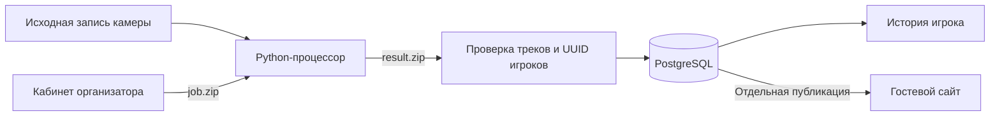

# AI Football

Сервис для организации футзальных турниров и анализа записей матчей со статичной камеры.

[](https://github.com/TimPad/AI-football/actions/workflows/ci.yml)

**Текущая поставка:** локальный кабинет организатора, гостевой сайт и внешний импорт видеоаналитики. Оператор обрабатывает исходное видео отдельно, проверяет соответствие треков игрокам и публикует выбранный результат. Счёт, голы и карточки ведутся в ручном протоколе. Добавлены ручная разметка участия/действий и пилотные матчевые и турнирные рейтинги с независимой публикацией.

## Возможности

- **Турниры и расписание:** быстрое создание черновика или мастер с регламентом, командами и игроками; Excel `.xlsx` с сопоставлением колонок, предпросмотром и исправлением ошибок, календарь и места проведения.
- **Команды и игроки:** единая форма команды с логотипом и составом, фото и основные параметры игроков; стабильные UUID людей.
- **Залы и камера:** адрес с подсказками Яндекса при подключённых ключах, ручной ввод и размеры поля, контрольные точки, гомография и версии калибровки; снимок геометрии матча. Яндекс Карты служат навигации.
- **Протокол:** ручные события и часы, подтверждение, история изменений, отдельная публикация; сохранение ввода и безопасные повторы запросов.
- **Сайт зрителя:** главная с календарём дня, группами турниров, ближайшими играми и топ-5 опубликованного рейтинга выбранного турнира; команды и игроки из опубликованных составов, турнир с календарём «время × зал», страница матча «Обзор / События / Составы / Статистика / Видео» по образцу FotMob (пустые вкладки скрыты): авторы голов в шапке, лента событий, сравнение команд по таймам (протокол, проверенные действия, CV), карта ударов, статистика игроков; карточка игрока и история опубликованных оценок; только публичные данные, плеер ВК по нажатию. Отчёт CLI `report.html` — технический экспорт, основной отчёт — веб.
- **Кабинет:** вверху «Турниры» и меню «Справочники» (команды, игроки, залы); внутри турнира — разделы «Матчи / Команды / Рейтинги / Настройки» и очередь «Обработка» для Админ+, у матча в списке отметка «На сайте».
- **Кабинет матча:** четыре раздела — «Обзор» (готовность и одна кнопка следующего шага), «Протокол» (сведения, состав, события, в том числе «Только итог»), «Видео» (проверка записи в трёх панелях, участие и действия) и «Публикация» (независимые публикации и предпросмотр отчёта).
- **Пилотные рейтинги:** подтверждённые интервалы участия/ролей, канонические действия, per10 и владение, оценки с объяснением, общий/позиционные списки, версии policy/reference и отдельные публичные срезы.
- **Видеоаналитика:** задание ZIP, локальный Python-процессор, проверка пакета, миниатюры и ручное назначение треков людям, метрики/карты, история игроков и независимая публичная версия.
- **Сопоставление с составом по кандидатам:** обработчик склеивает куски одного игрока в кандидатов (`analytics/track_groups.py`: все концы треков сразу, венгерский алгоритм; продолжение — после конца или дубль до 1 с в той же точке, переход физически возможен, через линию скамейки с паузой не склеивается) и кладёт их в `track-index.json` полем `groups`. В «Проверке» режим «По игрокам»: один выбор игрока на кандидата, «Разделить», «Объединить с…», номер, прочитанный на одном фрагменте, — подсказка для всего кандидата. Замер `scripts/eval_identity.py` по ручной разметке обрывов (`data/gt/*/links.json`): Ярославль 1:00–4:00 — точность 1,0 при полноте 0,88 (14 из 16 связок), независимый 10:00–13:00 — 0,91 и 0,83 (10 из 12); 41 трек игроков → 23 кандидата и 49 → 32. Сервер принимает у одного игрока перекрытие фрагментов до 1 с (передача между треками).
- **Данные для оценок без ручной разметки:** подтверждение видеоанализа само создаёт подтверждённые версии участия и действий с пометкой «авто по видео» (`service/ratings/auto.py`). Участие — время на площадке по фрагментам, назначенным игроку; разрыв до 20 с засчитывается, если на площадке не оказывается больше игроков, чем по регламенту; база времени — «время присутствия с паузами», амплуа не назначаются. Действия — передачи по мячу с автором и адресатом по назначенным фрагментам, категория «частично». Публикация видеоанализа ставит эти версии источниками оценок на сайте, если администратор не выбрал свои; ручная версия всегда главнее. Методика не меняется: частичная категория в оценку не входит, а минуты и известные передачи видны в разборе с пометкой «По автоматическим данным видео». На Ярославле (3 мин) сумма времени на площадке — 931 и 923 с при 5 × 186 = 930 с.

## Кабинет капитана и сквозное управление

Капитан регистрируется на `/captain/register`, подтверждает email, создаёт свою команду и состав вручную или из Excel. Для существующей команды организатор выдаёт приглашение либо рассматривает запрос на владение. Исправления общей карточки уже существующего человека проходят предложением организатору; UUID сохраняется. Турнирные заявки имеют неизменяемые отправленные версии, организатор принимает конкретную версию или возвращает её с причиной.

После импорта и подготовки видеоанализа Админ+ выдаёт каждой стороне задание сопоставления. Капитан видит кадры и снимок состава только своей команды, выбирает игрока для группы фрагментов либо явно указывает неизвестного/ошибку и самостоятельно подтверждает свою сторону. Подтверждения команд независимы; техническое подтверждение всего анализа и публикация остаются отдельными действиями Админ+. В очереди «Обработка» видны готовность сторон, устаревший контекст и следующий шаг.

Для писем заполните `CAPTAIN_MAIL_KEY` (Fernet key), `CAPTAIN_SMTP_HOST/PORT/USER/PASSWORD` и `CAPTAIN_MAIL_FROM` из `.env.example`; `ALLOWED_ORIGIN` должен указывать на адрес сайта. Ключ создаётся локально командой `.venv/bin/python -c "from cryptography.fernet import Fernet; print(Fernet.generate_key().decode())"` и хранится как секрет. Доставку выполняет `.venv/bin/python -m aifootball.service.captains.mail`: запускайте её регулярно внешним планировщиком. Письма находятся в зашифрованной очереди, содержимое удаляется после доставки или истечения срока; при недоступной почте UI объясняет проблему.

Очистку истёкших предпросмотров Excel запускайте регулярно: `.venv/bin/python -m aifootball.service.catalog.roster_imports.cleanup`. Срок — семь дней; результат уже применённой команды сохраняется для повторов.

Для адресных подсказок подключите оба ключа Яндекса, `ADDRESS_SIGNING_SECRET` и включите `YANDEX_ADDRESS_ENABLED` после проверки условий использования. Без провайдера адрес можно ввести вручную. Живые SMTP и Яндекс требуют проверки в конкретной установке.

[Приёмка полной UX-поставки](docs/2026-10-18-tournament-captain-ux-acceptance.md) содержит сценарии, проверки и ограничения.

## Оценки игроков и турнира

1. Завершите и подтвердите ручной протокол матча. Админ+ открывает «Видео и аналитика» → «Участие, действия и оценки».
2. В «Участие и роли» выберите подтверждённый протокол, шкалу/базу времени, проверьте повторные выходы и роли. Отдельно укажите интервалы мяча в игре и владения, если они известны. Сохраните подтверждённую версию.
3. В «Действия и полнота» выберите эту версию участия, внесите проверенные действия и полноту каждой категории. Свяжите голевой удар с официальным голом. Принятый Qwen-эпизод не означает полноту категории. Сохраните подтверждённую версию действий.
4. На странице турнира откройте «Рейтинги» и рассчитайте приватный срез. Доли и показатели на 10 минут сохраняют числители/знаменатели; без обязательных данных или базы сравнения балла нет. Издание фиксируется для фильтров и страниц.
5. Для сайта отдельно опубликуйте протокол и связанный CV-отчёт, разрешите выбранные версии участия/действий и методику в матче. Разрешённая версия действий также даёт командную статистику и карту ударов на странице матча. Затем рассчитайте **публичный** срез турнира и нажмите «Опубликовать рейтинг». Приватный срез напрямую публичным не становится.

Минимальная база — 5 игроков / 20 допустимых выступлений **в каждой роли**. Основной список требует 3 оценённых матча, 20 минут и покрытия ≥80%; остальные игроки показаны отдельно. Это стартовые настройки `role-profile-v1`, а не подтверждённая оценка силы. Плохая камера или неизвестная категория не заменяются нулём и не убираются из весов. Смена роли в каталоге не переписывает историю.

[Приёмка, формулы, ограничения и воспроизводимая проверка](docs/player-ratings-local-acceptance.md). API Qwen и Linux GPU ещё требуют отдельной live/спортивной приёмки; S3, подключённый Processor и облачное развёртывание остаются следующими этапами.

## Архитектура



В первой поставке видео остаётся у оператора. На сервер возвращаются JSON, интервалы, проверки качества и миниатюры. Приватные пакеты и вложения хранятся отдельно от Git и входят в резервную копию.

**Стек:** Python 3.12+, FastAPI, SQLAlchemy/Alembic, PostgreSQL 16, Polars/OpenCV/Ultralytics, React 19, TypeScript, Vite, Vitest и Playwright. Python-зависимости зафиксированы в `uv.lock`, frontend — в `web/package-lock.json`.

## Локальный запуск

Потребуются Python 3.12, `uv`, Node.js 24 и работающий Docker с Compose. Команды выполняются из корня проекта.

```sh
git clone https://github.com/TimPad/AI-football.git
cd AI-football
uv sync --locked --all-extras
npm --prefix web ci
cp .env.example .env
```

Заполните в `.env` `PGPASSWORD` и тот же пароль в `DATABASE_URL` вместо `CHANGE_ME`. При специальных символах пароль в URL должен быть URL-encoded. `.env` не добавляется в Git.

```sh
chmod 600 .env
docker compose up -d db
.venv/bin/python -m alembic upgrade head
.venv/bin/python -m aifootball.service.auth.cli create-admin --login admin
npm --prefix web run build
.venv/bin/python -m uvicorn aifootball.service.app:create_app --factory --host 127.0.0.1 --port 8000
```

Создание администратора запрашивает пароль интерактивно; этот шаг выполняется один раз для новой базы. При обновлении существующей установки повторно примените миграции и соберите frontend, сохранив базу и папку вложений.

- Гостевой сайт: <http://127.0.0.1:8000/>
- Кабинет: <http://127.0.0.1:8000/login>
- OpenAPI: <http://127.0.0.1:8000/docs>
- Готовность: <http://127.0.0.1:8000/api/v1/ready>

Для разработки интерфейса: `npm --prefix web run dev` в отдельном терминале при работающем API. За деталями конфигурации и восстановления см. [инструкцию сервиса](docs/service-stage1.md).

## Обработка видео

1. Сохраните составы обеих команд, зал и калиброванный профиль камеры в матче.
2. Админ+ открывает «Видео и аналитика», создаёт задание и скачивает `job.zip`.
3. Поместите доверенные веса `yolo11m.pt` в локальную папку `models/`. Веса и исходное видео не входят в репозиторий.
4. На компьютере с записью запустите:

```sh
.venv/bin/python -m aifootball.cli process-job --job job.zip --video match.mp4 --output result.zip
```

Для фрагмента матча добавьте `--partial-recording`; для известных интервалов записи — `--halves 0:40-21:50,27:10-46:00`.

Передачи считаются автоматически, если указать модель мяча, обученную для этого зала: `--ball-model ball_hall/best.pt` (файл внутри `models/`). Кадры обрабатываются с частотой самого видео: 25 кадров/с → 25, 30 → 30. Видео чаще 30 кадров/с идёт через равный шаг: 50 → 25, 60 → 30. Передачи считаются при частоте не ниже 15 кадров/с. Пакет получает версию 3 с `events.json`: передачи по трекам, имя и SHA256 модели мяча. Если мяч найден меньше чем в 30% кадров, передачи в пакет не попадают, а в проверках качества появляется причина. После публикации видеоанализа у зрителя в «Статистике» появляются «Передачи» и «Точные передачи» с пометкой «авто». Число передач приблизительное: по ручной разметке пяти отрезков двух залов Ярославля (отбор не считается передачей) находится 5–8 передач из 10, а из найденных верны 50–80%, поэтому итог может быть и выше, и ниже настоящего. Размеченные вручную передачи главнее автоматических. Удары, перехваты и потери пока не публикуются: их точность ниже порога.

Профиль камеры размечается кликами: в карточке зала нажмите «Взять кадр из записи» (браузер вырежет кадр из файла матча в его исходном разрешении; видео на сервер не уходит) или загрузите стоп-кадр картинкой, затем отметьте на кадре четыре угла поля и, по желанию, другие точки разметки из списка (центр, отметки 6 и 10 м, штанги ворот — метры подставляются по размерам зала). Размер кадра определяется по изображению, а после сохранения тот же кадр становится эталонным. Ввод координат числами, контур и калибровка объектива — в свёрнутом блоке «Для специалиста», только для Админ+.

Камеру между днями могут чуть повернуть или задеть. Даже сдвиг на 10 px даёт ошибку координат до 1,7 м в дальней половине. Поэтому в карточке зала к версии профиля камеры загружается эталонный кадр: та же камера, то же положение и разрешение, что и при разметке точек. Поверх кадра рисуются точки и контур поля — видно, легли ли они на разметку. Кадр попадает в `job.zip`. Перед детекцией обработчик сверяет с ним начало записи и затем каждую минуту по неподвижному фону: стенам, трибунам, разметке.
- Небольшой поворот поправляется автоматически. На записях Ярославля после поправки ошибка 0,06–0,09 м по медиане против 0,3–6 м без неё.
- При большом сдвиге обработка останавливается сразу и просит новую версию профиля.
- Если камеру сдвинули посреди записи, подтверждение блокируется с указанием времени.
- Если фон не сопоставился, остаётся предупреждение, а калибровка используется как есть.

Кадр задаётся один раз для версии профиля. Задания, выданные до его загрузки, нужно создать заново.

5. Загрузите `result.zip` в тот же матч, сверьте команды и миниатюры, назначьте фрагменты UUID игроков, сохраните и подтвердите аналитику.
6. Отдельно выберите публикацию для зрителей. История каждого игрока учитывает одну активную версию на матч.

Право Админ+ выдаётся владельцем установки явно, существующим администраторам оно автоматически не добавляется:

```sh
.venv/bin/python -m aifootball.service.auth.cli grant-analytics --login admin
# Отзыв: revoke-analytics вместо grant-analytics
```

[Полная инструкция, контракт и ограничения](docs/2026-10-14-analysis-stage1.md).

Для подсказок номеров и эпизодов установите `uv sync --locked --extra web --extra vlm`,
заполните локальные `DASHSCOPE_API_KEY` и `DASHSCOPE_BASE_URL` из `.env.example`.
Ключ должен относиться к выбранному региону Singapore. Исходное видео и короткие
выбранные кадры/клипы передаются региональному Qwen API при явном `--understand`.

```sh
.venv/bin/python -m aifootball.cli process-job --job job.zip --video match.mp4 \
  --output result.zip --understand --work-dir output/match-work \
  --vlm-mode native --analysis-scope continuous_excerpt --partial-recording \
  --vlm-max-requests 8 --vlm-max-input-tokens 60000 --vlm-max-output-tokens 20000
# После остановки: та же команда с --resume и теми же лимитами.
```

Нужны FFmpeg/ffprobe. Без `--understand` платных запросов нет. `frames` вместо
`native` отправляет JPEG без нативного клипа. Результат v2 содержит наблюдения и
закрытые JPEG; MP4/WAV остаются локально. В кабинете Админ+ проверяет номер по
кадрам и принимает, исправляет или отклоняет эпизоды. Это не меняет протокол.
Лимит запросов жёсткий; токены до ответа оцениваются приблизительно, а фактический
расход сохраняется. Прерванный запрос с неизвестным расходом не возвращает бюджет.

[Приёмка Qwen, ограничения и контейнер](docs/2026-10-14-qwen-local-acceptance.md).

## Проверки

При подготовленной `.env` и работающем PostgreSQL:

```sh
.venv/bin/python -m pytest --tb=line -q
npm --prefix web run test
npm --prefix web run build
web/node_modules/.bin/playwright install chromium
npm --prefix web run test:e2e
```

E2E запускает собственный API на порту 8181; порт должен быть свободен. Серверные тесты используют отдельные `aifootball_test` и `aifootball_migration_test`, E2E — `aifootball_e2e`. Рабочая база не очищается. Тяжёлый тест реального YOLO по умолчанию исключён; для него нужны локальные записи и модели.

После изменения API:

```sh
.venv/bin/python scripts/export_service_openapi.py --output data/service/openapi.json
npm --prefix web run types:api
```

GitHub Actions проверяет backend на PostgreSQL, frontend, сборку, соответствие типов API и сквозные Chromium-сценарии. CI использует синтетические данные и тестовые учётные записи, без рабочих видео и секретов.

## Документация

- [Навигация по документации](docs/README.md)
- [Сервис: запуск, права, протокол и резервные копии](docs/service-stage1.md)
- [Первая поставка аналитики: использование и приёмка](docs/2026-10-14-analysis-stage1.md)
- [UX/UI вокруг матча: приёмка первой поставки](docs/2026-10-15-ux-ui-acceptance.md)
- [Интерактивная HTML-архитектура](docs/architecture/2026-10-13-video-analytics.html) — скачать и открыть в браузере
- [План следующих поставок](docs/superpowers/plans/2026-10-13-video-analytics-import.md)
- [История поставки](CHANGELOG.md)
- [Разработка и проверки](CONTRIBUTING.md)

## Статус и следующие шаги

Локальная приёмка 15 октября 2026 (пересборка UX/UI): **671 backend-проверка, 118 UI-проверок, 13 E2E-сценариев**, сборка и точное восстановление резервной копии E2E-базы. Предыдущая приёмка 14 октября: 351 / 28 / 8. Отдельно реальный фрагмент 186,4 с прошёл обработку и импорт с разрешёнными демонстрационными UUID.

Это пилотная реализация. Реальные личности и спортивная точность на полном матче требуют проверки оператором. Номер формы пока помогает ручному сопоставлению; автоматический OCR и маски сегментации не реализованы. «Время в анализируемом видео» не считается игровым временем, пропуски не заменяются нулями.

Google Drive + Colab Pro выбран как кандидат для следующего ручного запуска; готовый Colab-ноутбук и полноценное возобновление вычислений ещё предстоит добавить. Подключённый Processor с автоматическим обменом, S3/GPU-обработчик и публичное размещение сайта — следующие этапы.

Локальные видео, модели, `.env`, базы, резервные копии, пакеты результатов и снимки экрана исключены из Git. Их нужно готовить отдельно в своей установке.
