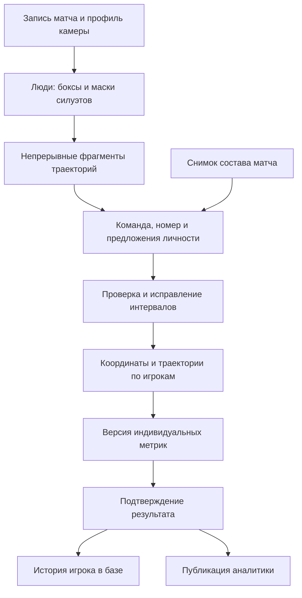

# Индивидуальная видеоаналитика и история игрока

Дата: 13 октября 2026. Статус: архитектурное предложение для обсуждения; перечисленные новые таблицы, API и экраны ещё не реализованы.

## 1. Результат, который должна давать система

После обработки записи организатор получает индивидуальную статистику участников конкретного матча. Карточка игрока показывает историю матчей, суммарные показатели, динамику и ссылки на подтверждающие видеофрагменты. Исправление ошибочной личности или повторная обработка не теряют исходные данные и не удваивают статистику.

Требование пользователя: выделять игроков на видео и сохранять по каждому данные обработанных матчей. Рабочие допущения: анализ после матча, существующий кабинет организатора, одна основная камера, постоянные `player_id`, возможность ручной проверки. Первый результат — физическая активность и позиции; автоматические передачи, удары и другие события развиваются отдельно. Прямой эфир и одновременное объединение нескольких камер не входят в первую поставку.

Критерий успеха: из любой цифры в карточке игрока можно установить матч, версию расчёта, учтённые интервалы, объём наблюдений и происхождение привязки личности. Неизвестный человек остаётся неизвестным; недостаток данных отражается в интерфейсе.

## 2. Что уже есть и где проходит граница

- `players.id` — постоянная личность; `team_members` — постоянный состав команды; `entry_players` — заявка турнира; `lineup_members` — состав конкретного матча со снимком имени и номера.
- Текущий конвейер: `detect → track → project → metrics/report`. Детекции, треки и координаты сохраняются в Parquet; отчёт — JSON/HTML.
- Сейчас выделяются прямоугольники людей. Пиксельных масок силуэтов, OCR номеров, веб-загрузки видео, сервисной очереди и индивидуальных результатов в PostgreSQL ещё нет.
- Текущие метрики и строки отчёта группируются по `track_id`. Подпись «Игрок 1» не обозначает человека из справочника. В отчёте есть фильтр треков короче 60 секунд; для будущей истории игрока такое отбрасывание до объединения недопустимо.
- Текущий читатель кадров вычисляет время через номер кадра и FPS. Для новых импортированных записей нужен проверенный таймлайн, учитывающий реальные временные метки кадров.
- Исторический прогон Костромы в `docs/phase1-results.md` показал разрывы треков и ошибки точки касания пола. Это основание для проверки, а не оценка качества нынешней версии на всех видео.

Новый модуль дополняет [спецификацию турнирного сервиса](2026-10-13-tournament-service-design.md) и [описание карточки команды](../2026-10-13-team-profiles.md). Официальный протокол остаётся самостоятельным источником подтверждённых результатов и событий.

## 3. Варианты и выбранный подход

| Вариант | Польза | Ограничение |
|---|---|---|
| Ручная идентификация всех фрагментов | Простой старт, контроль личности | Много работы при частых разрывах |
| Полностью автоматическая идентификация | Меньше действий оператора при хорошем видео | Незаметные ошибки загрязняют историю игрока |
| Автоматические предложения и проверка | Постепенная автоматизация, исправляемые результаты | Требуется удобный экран проверки |

Рекомендуется третий вариант. Сначала каждое назначение подтверждается человеком, в том числе пакетно после просмотра предложенной группы. Автоматическое подтверждение включается позже для проверенных условий съёмки; порог определяется на независимых записях. Значение уверенности модели само по себе не означает вероятность правильной личности.

## 4. Слои обработки

**Выделение человека.** Целевой новый конвейер сохраняет отдельные экземпляры людей: бокс, маску видимой части силуэта, уверенность и признаки качества. Маска помогает выбирать пиксели формы и исключать фон; восстановление скрытого тела не выдаётся за наблюдение. При неудачной маске сохраняется бокс с соответствующей пометкой. Судьи, зрители и скамейка тоже могут быть обнаружены, но не включаются автоматически в статистику участников на поле.

**Траектория.** Трекер связывает наблюдения во времени. Короткий непрерывный фрагмент получает собственный UUID. Резкое изменение внешнего вида, невозможное перемещение, перекрытие и конфликт номеров вызывают разделение или запрос проверки. Предположительная сшивка фрагментов хранится как предложение, исходные фрагменты остаются доступными.

**Личность.** Команда, номер, внешний вид формы и непрерывность движения используются совместно. Признаки внешнего вида помогают внутри записи; в разных матчах личность закрепляется через существующий `player_id` и состав. Фото карточки — визуальная подсказка оператору. Автоматическое распознавание лица не требуется для этого проекта.

**Позиция.** Положение на поле определяется по оценке контакта с полом и проверенному профилю камеры. Маска сама по себе не гарантирует устойчивую точку контакта. Для сложных кадров сравниваются маска, нижняя граница бокса и ключевые точки ног; при плохой видимости качество позиции понижается. Преимущество каждого метода проверяется на ручной разметке.

Несглаженные позиции сохраняются отдельным артефактом: исходный кадр/время, пиксельная опорная точка, метод её получения, качество и координаты после проекции. Производная траектория по игрокам содержит ссылки на эти наблюдения, границы непрерывности и признаки восстановления. Это позволяет исправлять границы личности без повторного запуска детектора и без наследования сглаживания через чужого человека.

**Метрики.** Расчёт работает на подтверждённых интервалах личности и принятых позициях. Неизвестные фрагменты сохраняются отдельно. Все исходные люди остаются доступными для последующей идентификации.

Instance segmentation действительно возвращает отдельные маски объектов; pose estimation возвращает ключевые точки. Это разные виды данных, и ни один из них сам по себе не устанавливает личность. См. [Ultralytics: segmentation](https://docs.ultralytics.com/tasks/segment/) и [pose](https://docs.ultralytics.com/tasks/pose/). Выбор весов и частоты обработки проводится замером на своих видео; переход на новую модель только из-за её новизны не требуется.

## 5. Запись, камера и время

Видео — самостоятельный неизменяемый объект с контрольной суммой, размером, длительностью, параметрами потоков и результатом проверки декодирования. Один файл может содержать несколько матчей; один матч может состоять из нескольких файлов. Контрольная сумма позволяет повторно использовать оригинал, но не объединяет разные матчи.

В карточке матча выбираются интервалы записи. Каждый интервал содержит источник, границы, положение на таймлайне матча и версию профиля камеры. Последовательные части не должны перекрываться на каноническом таймлайне. Если добавлена альтернативная съёмка того же момента, в первой версии выбирается одна основная запись; остальные доступны для проверки, без суммирования их траекторий.

Храним три различимых шкалы времени: время исходного видео, время собранной записи матча и официальное игровое время тайма. Границы — целые микросекунды, интервалы полуоткрытые `[начало, конец)`, с привязкой к исходным временным меткам кадров. Для переменной частоты кадров нельзя использовать только `frame_id / fps`. Прокси для браузера и обрезанные фрагменты получают явное отображение в исходник.

Таймы, перерывы, остановки часов, монтаж, повторы и отсутствующие части размечаются отдельно. Первая версия допускает ручную разметку таймов и исключённых интервалов. Без подтверждённой привязки к игровым часам показывается время записи. Метрики по выбранным таймам могут включать движение во время остановок; режим «только мяч в игре» доступен лишь при проверенной разметке и имеет отдельную версию определения.

Перемещение камеры требует другого профиля или разделения записи. Неподходящая калибровка блокирует публикацию метров и скорости для затронутого участка; видео и идентификация доступны. Набор версий калибровки сохраняется вместе с результатом, включая направление атаки команд в каждом тайме.

## 6. Привязка фрагмента к игроку

Ключ наблюдения: `processing_run_id + input_segment_id + local_track_id`. Пользователь работает с UUID фрагмента, а не с числом трекера. Число `17` в другом видео или новом прогоне может обозначать другого человека.

Назначение содержит ревизию проверки, UUID фрагмента, интервал исходного видео, `player_id`, сторону состава матча, способ предложения, подтверждение и ссылки на кадры-доказательства. В неизменяемом снимке ревизии сохраняются состав матча, отображаемые имена и номера. Изменение постоянного состава команды не переписывает исторические назначения.

Обязательные ограничения:

1. Назначить можно только игрока из снимка состава этого матча. Ошибка состава исправляется явно: создаётся новая ревизия со скорректированным снимком и повторной проверкой затронутых назначений.
2. Один интервал фрагмента не назначается двум людям. Отсутствие назначения означает «неизвестный».
3. У одного человека может быть много фрагментов. Номер формы не является глобальным ключом личности.
4. Одновременные фрагменты одного игрока в одной основной камере требуют разрешения: выбрать качественное наблюдение, отметить дубль или исправить личность. До разрешения двойного учёта подтверждение блокируется.
5. Распознанные команды A/B явно сопоставляются с домашней/гостевой сторонами. Цвет вратаря и выход полевого в роли вратаря допускают отдельную форму; смена ворот не меняет команду.
6. При переключении личности трек делится во времени. Сглаживание и скорость пересчитываются внутри новых границ по исходным позициям: простое разделение уже сглаженного `state.parquet` может сохранить ошибочный переход между людьми.

Сервис и база проверяют принадлежность фрагмента прогону выбранной ревизии, совпадение матча и попадание назначенного диапазона внутрь исходного фрагмента. Метрики также относятся к матчу через свою ревизию; нельзя записать результат другого матча с произвольным повторным `match_id`.

Например: в первой половине трека №17 находится Петров, после перекрытия — Сидоров. Сохраняются два назначения с точной границей. Старый трек не удаляется. Между людьми не вычисляются дистанция, ускорение и спринт.

## 7. Номер на форме и автоматические предложения

OCR выбирает несколько качественных кадров с читаемой областью номера; учитываются размер, резкость, перекрытие и ракурс. Сохраняются исходные чтения, время, кадр и версия модели. Повторение одинаковой цифры на соседних почти одинаковых кадрах не считается множеством независимых доказательств.

Сопоставление производится с номером из состава конкретного матча и предполагаемой командой. Номер 7 у обеих команд — два кандидата. Номера хранятся строками, как в существующих моделях; исходное чтение сохраняется. Нормализация «07» в «7» не должна молча разрешать неоднозначность состава. Неизвестная команда, невидимый номер, противоречивые чтения и отсутствующий в составе номер возвращают неопределённость, а не принудительный выбор.

Номер, прочитанный на одном надёжном участке, помогает предложить личность всего непрерывного фрагмента. Перенос через перекрытие, длинный разрыв или смену номера требует дополнительных оснований. При конфликте уверенное ручное подтверждение не перезаписывается автоматикой; создаётся замечание на проверку.

Распознавание номеров по последовательности изображений используется в исследовательской задаче [SoccerNet Jersey Number Recognition](https://www.soccer-net.org/tasks/jersey-number-recognition). Авторы отмечают низкое разрешение, размытие и редкую видимость номера. Это подтверждает применимость подхода, но не устанавливает точность на наших футзальных записях.

## 8. Что хранится в PostgreSQL и что — в файлах

В PostgreSQL сохраняются личности, интервалы, версии, статусы, компактные результаты и их происхождение. Покадровые боксы, маски, координаты и признаки хранятся в версионированных артефактах Parquet/сжатых файлах в закрытом объектном хранилище. Для небольшой записи локальный файловый адаптер допустим; интерфейс хранения общий. Существующие вложения протокола до 20 МБ не используются для видео.

| Предлагаемая сущность | Основные поля и назначение |
|---|---|
| `video_assets` | UUID, ключ оригинала/прокси, SHA-256, размер BIGINT, длительность, параметры потоков, состояние проверки |
| `match_video_segments` | Матч, источник, границы исходника, смещение таймлайна, основной/вспомогательный источник, профиль камеры |
| `camera_profile_versions` | Неизменяемые размеры поля, геометрия, параметры, хеш снимка конфигурации |
| `processing_runs` | Матч, неизменяемый манифест входных сегментов, модели и хеши весов, версия кода/схем, параметры, состояние |
| `processing_jobs` | Этап, входной хеш, попытка, прогресс, владелец аренды, срок аренды, ошибка/отмена |
| `run_artifacts` | Прогон, тип, версия схемы, ключ файла, SHA-256, число строк, временной диапазон, входные зависимости |
| `tracklets` | UUID фрагмента, прогон/сегмент/local ID, границы, предложения команды/роли/номера, качество, ссылки на миниатюры |
| `analysis_revisions` | Матч/прогон, номер ревизии, снимки состава, времени и команд, версия правил метрик, хеш, состояние проверки/расчёта |
| `identity_assignments` | Ревизия, UUID фрагмента, диапазон времени, FK игрока, сторона, способ, подтверждение, доказательства |
| `analysis_commands` | Автор, request ID, хеш запроса, ожидаемая ревизия, изменение, результат; идемпотентность и аудит |
| `player_match_metrics` | Ревизия, матч, игрок, период, показатели, качество, ссылки на траекторию/тепловую карту |
| `analysis_publications` | Матч, номер публикации, ревизия аналитики, зафиксированная версия протокола при её наличии, автор/дата |

В `matches` добавляются отдельные ссылки на текущую ревизию проверки, подтверждённую аналитику и опубликованную версию. Протокол сохраняет собственную ссылку `published_version_id`; аналитика не переиспользует её.

Содержимое новых ревизий проверки неизменяемо после записи; правка создаёт следующую. Служебное состояние расчёта/подтверждения может переходить между статусами, не меняя снимка входных данных. Ревизии содержат полное логическое состояние проверки, а не набор разрозненных текущих назначений. Для первого объёма допустимо копировать компактные интервалы предыдущей ревизии. Снимки конфигурации — JSONB/артефакты, основные измеряемые показатели — типизированные столбцы. Уникальный ключ метрик: `(analysis_revision_id, player_id, period_key)`. Периоды: весь выбранный матч и конкретный тайм; суммарный отчёт не складывает «весь матч» с его таймами.

Индексы: матчи по дате/турниру; результаты по игроку и матчу; фрагменты по прогону/сегменту/времени; задания по состоянию/аренде. Непересечение назначений одного фрагмента одной ревизии обеспечивается также базой через диапазоны и exclusion constraint. Для UUID + диапазона требуется совместимая GiST operator class, например `btree_gist`. [PostgreSQL: ограничения диапазонов](https://www.postgresql.org/docs/current/rangetypes.html#RANGETYPES-CONSTRAINT).

Маски и координаты не записываются как миллионы JSON-строк в `players`. Схемы новых артефактов версионируются явно; существующая `schemas.write` выбирает известные колонки и не сохранит добавленные маски автоматически. Старые артефакты остаются читаемыми своим адаптером и помечаются как результаты прежнего конвейера.

## 9. Индивидуальные показатели и качество

Для каждого участника состава создаётся строка результата матча, даже если подтверждённых наблюдений нет. Это `no_data` с пустыми аналитическими значениями, а не нулевой пробег. Официальные события при этом могут существовать.

| Показатель | Смысл |
|---|---|
| `observed_s` | Время реальных подтверждённых наблюдений, объединённое без дублей |
| `usable_motion_s` | Время пригодных для расчёта движения интервалов |
| `interpolated_s`, `rejected_s` | Сколько данных восстановлено или исключено |
| `playing_s` | Игровое время только при отдельной надёжной разметке участия; иначе NULL |
| `coverage_pct` | Отношение наблюдаемого участия к известному участию на той же шкале времени; иначе NULL |
| `distance_m`, `hsr_m` | Дистанция на пригодных непрерывных участках и её часть выше порога интенсивности |
| `m_per_min` | Дистанция на минуту пригодных интервалов, с явным знаменателем |
| `sprints_count` | Спринты по опубликованному порогу скорости и минимальной длительности |
| `vmax_ms` | Устойчивая максимальная скорость; без достаточных измерений NULL |
| Тепловая карта | Время в ячейках поля с указанной ориентацией и разрешением |
| Состояние | Статус проверки и полнота данных хранятся раздельно; подтверждение не устраняет неполноту |

Логика расчёта:

- Сначала разрешаются дубли и границы личности, затем принимаются позиции, затем считаются метрики. Короткие подтверждённые фрагменты не отбрасываются из истории из-за порога отображения старого отчёта.
- Через длинный разрыв, монтаж, смену камеры, личности или исключённый эпизод не соединяется путь и не продолжается спринт. Короткая допустимая интерполяция имеет отдельный признак и ограничения.
- Время интервалов объединяется, не суммируется при перекрытиях. Для дистанции каждый переход учитывается один раз; его оба конца должны принадлежать одной личности и непрерывной совместимой траектории.
- После подтверждения сшивки соседних фрагментов можно пересчитать движение и спринты через их границу только при проверенной непрерывности. Автоматическое присвоение общего `player_id` такой непрерывности не доказывает.
- Пропуск камеры не означает уход со скамейки и не означает отсутствие участия. В первой версии надёжное индивидуальное игровое время может оставаться неизвестным.
- Дистанция за 8 минут наблюдений не подписывается как пробег за полный матч и не экстраполируется автоматически. Доля неизвестных игроков и потерь наблюдения показана в отчёте матча.
- Ограничение физической скорости служит проверкой/фильтром; обрезанный выброс не становится доказательством достигнутой скорости. Сохраняется количество отклонённых точек.

Пороги интенсивности, интерполяции, устойчивой скорости и выбор игрового/видеовремени входят в версию метрик. Для публикации сравнимых графиков используются совместимые определения. Показатели по вратарям и полевым можно фильтровать отдельно, при этом роль может меняться внутри матча.

Голы, ассисты, карточки и подтверждённые события берутся из версии официального протокола, без повторного счёта AI-кандидатов. Оценки передач, ударов и владения позднее получают отдельные поля со статусом проверки и ссылками на эпизоды. Отсутствие надёжного мяча не блокирует сохранение качественных физических показателей.

## 10. История игрока и отсутствие двойного счёта

`player_id` остаётся одним при переходе в другую команду. Историческая строка сохраняет матч, команду/сторону, имя и номер на момент снимка. Совпадение ФИО не объединяет людей. Объединение ошибочно созданных дублей игроков — отдельная контролируемая операция с аудитом.

История кабинета использует по одному подтверждённому результату на матч; публичная история — по одной опубликованной версии. Черновики доступны для сравнения, но не входят в суммарную статистику. Новый подтверждённый расчёт атомарно заменяет ссылку на активный результат, старый остаётся в истории версий. При выявленной серьёзной ошибке результат можно отозвать и исключить из итогов до исправления.

Итоги вычисляются из результатов матчей, а не накапливаются командами «прибавить пробег к карточке». Суммарная дистанция складывается по совместимым определениям, `m_per_min = сумма дистанций / сумма пригодного времени × 60`, максимум скорости — максимум пригодных устойчивых измерений. Не следует усреднять средние скорости матчей без веса или смешивать определения спринта.

Карточка показывает число матчей в составе, число матчей с видеоаналитикой и число матчей с подтверждённым участием отдельно. Первый показатель не доказывает выход на площадку. Фильтры: турнир, сезон, команда, даты, определение метрик, качество данных. Тепловые карты разных площадок сравниваются только после явного преобразования координат; сырые метровые сетки разного размера напрямую не складываются.

Кеш сезонных итогов возможен позже; его источник — выбранные ревизии и хеш фильтров. Повторный расчёт заменяет содержимое кеша, а не добавляет ещё одну копию матча.

## 11. Загрузка и надёжное выполнение

Подробный процесс загрузки и сравнение вычислительных площадок: [S3 и варианты обработчиков](2026-10-13-video-upload-and-workers-options.md).

Основной сценарий — файл из карточки матча в закрытое S3-совместимое хранилище. Большие файлы загружаются частями с возобновлением; завершение, размер, контрольная сумма и декодирование проверяются до допуска в обработку. Multipart позволяет повторять отдельные части; совместимость конкретного поставщика проверяется интеграционным тестом. [S3 multipart](https://docs.aws.amazon.com/AmazonS3/latest/userguide/mpuoverview.html).

Импорт файла Яндекс Диска — второй способ получения такого же проверенного оригинала. Ссылка ВК остаётся ссылкой просмотра, не заданием обработки. Браузер получает ограниченные ссылки на нужные файлы, а не открытый доступ ко всему бакету.

FastAPI управляет задачами и выдаёт статусы; отдельный Python-работник запускает существующие этапы через адаптеры. Сначала один работник и очередь заданий в PostgreSQL: выбор с блокировкой и `SKIP LOCKED`, ограниченная аренда, heartbeat, номер попытки и токен владельца. PostgreSQL описывает `SKIP LOCKED` как подход для нескольких потребителей очереди, а не для общего согласованного чтения. [Документация SELECT](https://www.postgresql.org/docs/current/sql-select.html).

Статусы оригинала: `uploading/importing → validating → ready`, либо `failed`. Статусы задания: `queued → running → succeeded`, либо `failed/cancelled`. Текущий этап хранится отдельно: segment/detect, track, identity proposals, project, metrics. Состояние проверки: требуется проверка, конфликт, рассчитано, подтверждено. «Обработка завершена» не означает «личности подтверждены».

Повторная доставка задания безопасна: входной хеш включает видео, выбранные интервалы, конфигурацию и зависимости этапа. Артефакт сначала записывается под уникальным ключом попытки, проверяется, затем регистрируется атомарно. Работник с истёкшей арендой не может завершить задание поверх нового владельца. Незавершённые файлы не используются; очищаются отдельной процедурой после проверки отсутствия ссылок.

Изменение имени или привязки пересчитывает соответствующий производный результат в новой ревизии. Изменение границы личности также пересчитывает затронутое сглаживание. Изменение профиля камеры создаёт новый прогон с переиспользованием совместимых детекций и пересчётом проекции/метрик: манифест старого прогона сохраняется. Изменение детектора, масок, видео или трекера тоже создаёт новый прогон; совместимые завершённые этапы можно переиспользовать по их хешам. Изменение только определения метрик создаёт новую аналитическую ревизию, сохраняя CV-артефакты. UI не делает длительную обработку внутри запроса.

## 12. Проверка, исправления и публикация

Вкладка матча «Видео и аналитика» содержит загрузку, интервалы/таймы, профиль камеры, прогресс и результат. На экране проверки рядом с плеером расположены состав и группы фрагментов; у каждого — несколько миниатюр, интервал, команда, прочитанный номер, предложенный игрок и замечания.

Действия: подтвердить личность, выбрать другую из состава, разделить в указанное время, объединить проверенные фрагменты одного игрока, отметить дубль/судью/скамейку, оставить неизвестным. Оператор видит, как изменятся наблюдаемое время и показатели выбранных игроков. Основной фильтр — конфликты и непроверенные участки; короткие фрагменты тоже доступны.

Сохранение выполняется командой с `request_id` и `expected_revision`, как в существующем сервисе. Запоздалое сохранение не затирает новые исправления. Параллельный расчёт фиксирует входную ревизию: если проверка изменилась, его результат сохраняется для старой версии, но не становится текущим автоматически.

При повторном трекинге ID могут поменяться. Прежние назначения сохраняются на прежнем прогоне; время, позиция и кадры используются для предложения переноса. Перенос требует проверки, не выполняется по совпадению local ID. Исправление только личности в том же прогоне не требует повторной детекции.

Подтверждение требует завершённого расчёта именно выбранной ревизии, согласованного состава и разрешённых конфликтов/дублей. Нераспознанные люди допустимы при явной отметке неполноты; их метрики не присваиваются именованным участникам. Это не публикация «полной индивидуальной аналитики».

Публикация закрепляет одну согласованную ревизию целого матча вместе с файлами отчёта, метриками и снимком протокола при наличии. Новая обработка создаёт черновик и не меняет опубликованные цифры до явного переключения версии. История публичного игрока обновляется вместе с этим переключением, без смешения старых и новых строк разных игроков.

## 13. Контракты API и границы модулей

Предлагаемые частные API: создание/возобновление/завершение загрузки; источники и интервалы матча; версии профилей камеры; запуск/отмена/статус прогона; фрагменты и кадры-доказательства; команды проверки; расчёт, подтверждение и публикация ревизии; история и метрики игрока. Публичные API выдают только опубликованные результаты с качеством и версией. Точные JSON-схемы фиксируются в плане каждого этапа и OpenAPI перед его реализацией.

Модули сервиса: `video` (источники и время), `processing` (задания и артефакты), `identity` (предложения и подтверждения), `player_analytics` (расчёт и история), `analysis_publication` (снимки). CV-код остаётся в существующих `perception`, `state`, `analytics`, доступен через файловые контракты. Модели сервиса не импортируются внутрь детектора.

Ключевой вычислительный контракт — подтверждённые интервалы личности + проверенные позиции + выбранные периоды → индивидуальные результаты и показатели качества. Генератор отчёта получает уже эти результаты, а не самостоятельно превращает номера треков в людей.

Служебный журнал сохраняет автора исправления и ссылки на предыдущую ревизию. Резервная копия включает новые таблицы, манифест файлов и оригиналы/артефакты, на которые ссылаются подтверждённые версии; восстановление проверяется отдельным тестом. Архивирование игрока скрывает его из нового выбора, но не обрывает исторические FK.

## 14. Проверка на реальных данных

Нужна ручная разметка людей и номеров на ближней/дальней части поля, перекрытиях, заменах и разных формах вратарей; отдельно — опорных позиций на поле и участия во времени. Замеры на коротких фрагментах дополняются хотя бы одним целым матчем. Записи для настройки и итоговой оценки разделяются, чтобы соседние кадры одного эпизода не попадали в обе группы.

Замеряем: пропуски и ложные люди, качество масок, переключения личности, разрывы на минуту, точность чтения видимых номеров, точность назначения игрока и долю назначенного времени, ошибки позиции/дистанции, объём ручных исправлений и длительность обработки. Точность номера на читаемых кадрах не выдаётся за долю успешно опознанных участников всего матча.

Перед автоматическим подтверждением предлагаемый критерий — нижняя граница 95% доверительного интервала точности назначения не ниже 99% в том подмножестве условий, где оно включается. Единица проверки — независимый назначаемый фрагмент; отдельно измеряется доля ошибочно присвоенного времени. Указывается размер выборки и распределение по записям, а не число соседних кадров. Это проектный критерий, не достигнутый результат. При недостаточной выборке или смене условий остаётся ручная проверка. Для физических метрик сначала фиксируются допустимые ошибки по ручному эталону; до этого они обозначаются как экспериментальные оценки.

Обязательные сценарии целостности:

1. Один игрок в пяти фрагментах: одна строка за матч, полные подтверждённые интервалы, без искусственного пути через разрывы.
2. Смена человека посреди трека: два человека, ни одного перехода движения между ними.
3. Два одинаковых номера у разных команд, нечитаемый номер и конфликт команды: отсутствие ложного назначения.
4. Дубли наблюдений одного человека: время/дистанция не удваиваются, конфликт виден до подтверждения.
5. Короткие фрагменты, отсутствие видео, частичная запись, неизвестное участие: корректные NULL и признаки неполноты.
6. Новый прогон с другими local ID, повтор команды, потеря ответа, конкурентная правка и авария работника: прежняя история остаётся воспроизводимой.
7. Изменение номера/команды/имени, архивирование, пересмотр протокола: прошлые снимки сохраняются, публикация переключается согласованно.
8. Много матчей в одном файле, несколько частей матча, переменный FPS, пропуск и монтаж: правильное время эпизода без двойного учёта.
9. Новый подтверждённый расчёт: число матчей и сезонные итоги не увеличиваются от версии.
10. Восстановление базы и файлов: тот же отчёт и связь каждой цифры с исходными интервалами.

## 15. Порядок реализации

1. **Основа видео:** отдельные источники, загрузка/проверка, интервалы, версии камеры, очередь с возобновлением и неизменяемые артефакты. Приёмка — запись запускается из карточки матча, отказ и повтор не теряют её.
2. **Индивидуальная аналитика с ручной проверкой:** маски/фрагменты, экран назначений и разделения, пересчёт по границам, `player_match_metrics`, подтверждение и история игрока. Приёмка — на реальном матче можно собрать одного участника из нескольких фрагментов, исправить ошибку и безопасно пересчитать.
3. **Подсказки личности:** много кадров номера, предложения сшивки, сортировка проблем, замер качества; затем ограниченное автоматическое подтверждение при пройденном критерии. Приёмка — меньше ручных действий при измеренной точности.
4. **Публикация и сравнение:** закреплённые версии, публичная индивидуальная статистика, совместимые фильтры сезонов и динамика. Публичная видимость карточек и фото задаётся отдельным явным правилом продукта.
5. **События и игровое время:** проверяемый мяч, замены/участие, передачи/удары/владение с отдельной валидацией. Их качество не подменяет качество уже сохранённых физических измерений.

Для каждого этапа нужен собственный небольшой план с миграциями, API, UI, проверками и измеримой приёмкой. Первая полезная поставка заканчивается вторым этапом: база уже хранит историю каждого игрока, даже до надёжного автоматического чтения номеров.

## Реализованная основа геометрии

После проектирования добавлены справочник залов, геометрический снимок матча и неизменяемые профили камеры с пиксельными/метрическими точками и экспортом в существующий CV CLI. Проектируемый воркер должен получать геометрию выбранного матча и конкретную версию камеры, а не текущую карточку зала или размеры из регламента. [Контракт и инструкция](../2026-10-13-halls.md). Сам конвейер идентификации игроков, видео/S3-задачи и таблицы индивидуальной аналитики этим изменением не реализованы.
