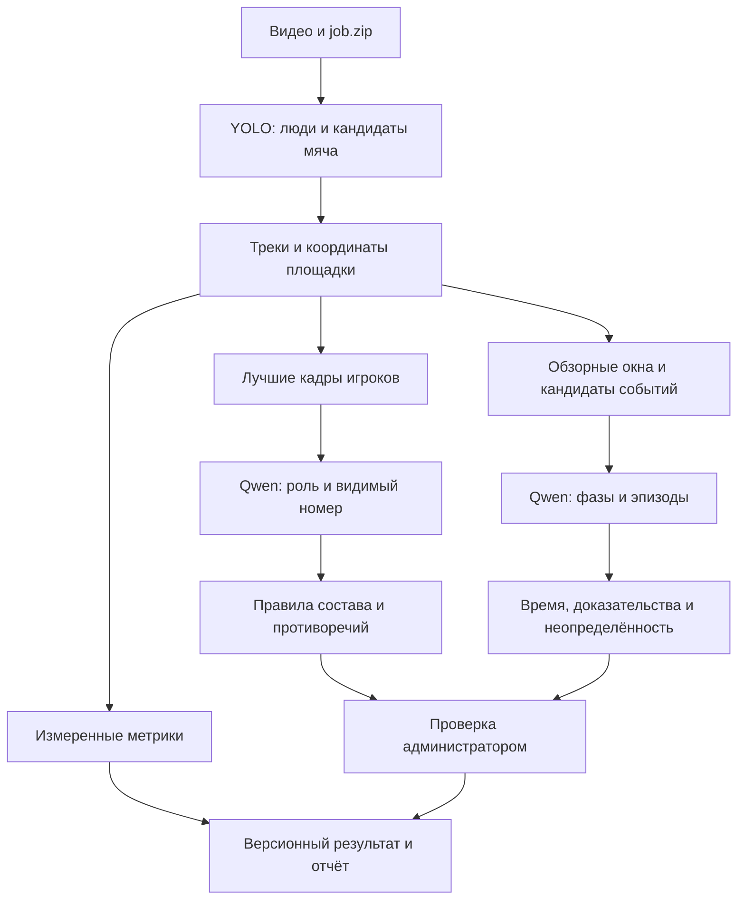

# YOLO и Qwen3.8-Omni-Flash: игроки и понимание матча

Дата: 14 октября 2026, Europe/Moscow.
Статус: архитектура утверждена пользователем; поставщик заменён на Qwen по его указанию.
Реализация ещё не выполнена. Эта редакция заменяет спецификацию DeepSeek.

## Цель и принятые ограничения

Дополнение пользователя: [оценки игроков и аналитика всего турнира](2026-10-14-player-ratings-tournament-design.md).
Qwen предоставляет проверяемые наблюдения для следующего рейтингового модуля;
оценки вычисляются по прозрачной формуле из подтверждённых фактов. Полная ручная
разметка поддерживает рейтинги до автоматизации всех действий; время видимости
треков не подменяет участие на площадке.

Пользователь выбрал Qwen3.8-Omni-Flash через официальный API и попросил включить
понимание матча уже в первую поставку, вместе с обнаружением людей и номеров.
Сначала система проверяется на локальном компьютере; после приёмки обработчик
переносится на прерываемую ВМ с GPU. Colab не является основным путём.
Для имеющейся записи разрешены демонстрационные обозначения игроков.

Результат: администратор получает предложения привязки треков к составу,
хронологию эпизодов, состояния игры и краткое объяснение с доказательствами.
Предложения не меняют официальный протокол и индивидуальную статистику без проверки.
Улучшение качества подтверждается сравнением на размеченных фрагментах, а не
наличием новой модели или уверенностью в её тексте.

## Проверенный API

По официальной документации, проверенной 14 октября 2026:

- Имя модели: `qwen3.8-omni-flash`; используем HTTP API для файлового анализа,
  а не отдельную модель `qwen3.8-omni-flash-realtime`.
- Входы: текст, изображения, аудио, видео; выход — текст.
- `DASHSCOPE_API_KEY` и `DASHSCOPE_BASE_URL` берутся из окружения. Адрес региона/
  workspace копируется из кабинета Model Studio/QwenCloud; регион ключа совпадает.
  Не вшивать адрес DeepSeek или универсальный URL, не соответствующий workspace.
- Chat Completions: POST `<DASHSCOPE_BASE_URL>/chat/completions`, потоковый ответ,
  `modalities: ["text"]`, `stream_options: {"include_usage": true}`.
- Изображения: блоки `image_url` с локальным JPEG в base64 data URL.
  Нативный клип: `video_url.url = "data:;base64,<encoded-video>"` по официальному
  примеру. Отдельное WAV-аудио: `input_audio` с data и format. Публичный URL не нужен.
- Начальный транспорт — `httpx` с потоковым SSE-парсером. JSON собирается только
  из `delta.content`; `reasoning_content` не смешивается с итоговым ответом.
  Незавершённый поток не считается валидным завершённым результатом.
- Для JSON Object режима выбирается `reasoning_effort: none`; инструкция содержит
  слово JSON. Провайдер гарантирует JSON-объект, не нашу схему. Собственный строгий
  валидатор обязателен. JSON Schema для этой модели не предполагается.
- Размер, число и продолжительность медиа контролируются локально; ограничения
  выбранного endpoint дополнительно проверяются коротким реальным smoke-прогоном.
  Наш предел: до 32 изображений, до 12 MiB тела, один клип до 20 секунд;
  base64 отдельного аудио/видео менее 8 MiB. Большой клип переразбивается.
  Это наши ограничения, а не заявленные лимиты Qwen.
- Qwen применяет собственную выборку кадров видео. Параметры выборки и фактически
  переданные локальные кадры сохраняются отдельно; нативное видео не объявляется
  просмотренным моделью покадрово. Для точных границ используются кадры исходника.
- Сохраняются запрошенная/возвращённая модель, версия промпта, endpoint/регион без
  ключа, настройки, request id, usage и дата. Если API не отдаёт неизменяемый
  идентификатор весов, отчёт не обещает его фиксацию.

Источники:
[карточка Qwen3.8-Omni-Flash](https://help.aliyun.com/zh/model-studio/qwen3-8-omni-flash),
[файловый мультимодальный API](https://help.aliyun.com/zh/model-studio/qwen-omni),
[QwenCloud: модель и вызов](https://www.qwencloud.com/models/qwen3.8-omni-flash),
[структурированный вывод](https://docs.qwencloud.com/developer-guides/text-generation/structured-output).

## Исходная реализация

- `processor/job.py`: локальный `job.zip` → CV → `result.zip`, снимок геометрии,
  составов, хеш исходника, проверки качества и ручной импорт.
- `perception/detect.py`: YOLO, люди и общий класс мяча; MPS/CUDA/CPU.
- `perception/track.py`, `stitch.py`: ByteTrack, цвет/геометрия, разрезание трека
  при смене цвета команды и соединение подходящих фрагментов.
- Привязка UUID выполняется администратором; назначение пересекающихся фрагментов
  одному человеку блокируется. Подтверждение и публикация независимы.
- Строгий ZIP-контракт принимает версию 1 и ограниченный перечень файлов.
  Просто положить дополнительные JSON в существующий архив нельзя.
- Время наблюдения трека не является игровым временем. Оценка границ таймов
  по количеству людей не распознаёт чистое время.

## Варианты и выбранный подход

1. **Выбран: YOLO/трекер плюс выборочные запросы Qwen.** Геометрия измеряет
   движение; VLM читает лучшие кадры и интерпретирует последовательности.
   Ограничены расход и размер запросов, сохраняются проверяемые доказательства.
2. Только периодические обзорные кадры VLM: проще, но быстрые события и номера
   между кадрами пропускаются; недостаточно для поставленной задачи.
3. Полностью локальная VLM: отдельное сравнение аппаратных требований и качества;
   не соответствует текущему выбору официального Qwen API.

## Поток данных

Размеры, полигон и калибровка камеры берутся из задания. Направление атаки
хранится отдельно от физической ориентации площадки и может меняться по таймам.
VLM не вычисляет дистанции, скорость и точные метрические координаты.

## Состав первой локальной поставки

| Группа | Выход | Когда результат неизвестен |
|---|---|---|
| Люди и идентификация | Игрок/вратарь/судья/неизвестно; видимый номер; признаки формы; предложение UUID | Номер закрыт, мало пикселей, номер неоднозначен, неизвестна команда |
| Состояния игры | До начала, игра, остановка, перерыв, после конца, неизвестно | Нет перехода на кадрах, монтаж, перекрытия, мяч не наблюдается |
| Возобновления и стандарты | Начальный ввод, ввод из аута, угловой, штрафной/пенальти как гипотеза; тайм-аут | Не видно решения судьи, места мяча или последующего ввода |
| Атакующие эпизоды | Возможный удар, отражение/сейв, возможный гол, момент у ворот | Траектория мяча или линия ворот не видны |
| Состав на площадке | Возможная замена, появление/уход игрока, выход вратаря | Игрок исчез за пределами камеры; нет признаков замены |
| Игровые фазы | Атака, оборона, переход; сторона владения либо неизвестно; направление атаки | Мяч не различим, покрытие площадки недостаточно |
| Тактический контекст | Ширина/глубина из координат, предположение о прессинге/компактном блоке, описание эпизода | Не все игроки видны или контекст слишком короткий |

Все группы входят в первую поставку как проверяемые гипотезы. Поддержка категории
не означает доказанную точность её распознавания на нашем видео.
Полный подсчёт передач, xG, автоматическое судейство и распознавание лиц в неё не входят.
Нарушение правил не выводится только из столкновения игроков; видимая остановка
судьёй и гипотеза причины хранятся раздельно. Звук исходного клипа (свисток, удар, комментарий ВК при наличии) входит в первый
эксперимент как дополнительный сигнал. Комментарий может запаздывать и ошибаться;
сам по себе он не подтверждает событие и личность игрока. Отсутствие аудиодорожки
явно фиксируется и не блокирует визуальную обработку.

## Кадры и временной контекст

Для каждого трека выбираются до 5 кадров разных моментов: размер игрока,
резкость и отсутствие перекрытия предпочтительнее случайной миниатюры.
Передаются кропы без дорисовки номера и небольшой контекст команды; читаемый
номер должен ссылаться на конкретные кадры. Несколько похожих соседних кадров
не считаются независимыми подтверждениями личности.

Сцена рассматривается двумя путями: регулярные окна для состояний/фаз и окна
вокруг кандидатов из движения мяча, игроков и зон площадки. Это снижает зависимость
от качества поиска маленького мяча. Отсутствие детекции мяча не означает паузу.

К обзорным окнам и кандидатам подготавливается синхронный MP4-клип со звуком
при его наличии. Клип сохраняет исходную временную привязку; время внутри него
переводится в `video_ms` исходника. Доступные кропы/кадры нужны для доказательств
и уточнения границ. В первой поставке нативные клипы и контрольный режим кадров
сравниваются на одинаковой разметке; режим сохраняется в кэше и отчёте.

Начальные параметры для эксперимента: обзорное окно 12 секунд с шагом 6 секунд,
выборка 1 кадр/с; кандидат события — контекст до/после с повторной выборкой
до 4 кадров/с в спорной зоне. Один запрос содержит не более 32 изображений и
12 MiB тела. Эти параметры настраиваются; не являются гарантией полноты или точности.
Результат указывает фактическую частоту и диапазон покрытых кадров.

Каждый кадр имеет собственные `frame_id`, `video_ms`, хеш и область кропа.
VLM получает кадры по времени и различает сцену и кроп одного момента.
Граница события — интервал между наблюдениями, а не выдуманная точная миллисекунда.
Уточнение требует дополнительных кадров. Одна неподвижная картинка не доказывает
удар, передачу, остановку, замену или гол.

Пересекающиеся окна согласуются по типу, стороне, участникам и диапазону времени;
разные типы одного момента не объединяются вслепую. Стабильный id строит обработчик
из хеша исходника, версии промпта и нормализованного кандидата, а не модель.
Ответ за пределами переданного окна отклоняется. Для состояний формируется
непересекающаяся шкала: противоречие двух окон даёт `unknown` до проверки.
Через непокрытый участок нельзя продлевать состояние игры или владение.

## Идентификация и согласование

Ответ VLM содержит только роль, наблюдаемый номер/признаки и ссылки на кадры;
модель не назначает UUID. Сопоставление выполняется по снимку состава матча,
подтверждённому соответствию A/B и сторон home/away, номеру и непротиворечивым
наблюдениям. Дубли номеров и неизвестная сторона дают несколько кандидатов
либо `unknown`. ФИО и фотографии состава не нужны для запроса VLM.

Внутритрековые противоречия номера не разрешаются голосованием всего трека:
показывается возможная смена личности и предлагается пересчёт/разрезание.
В первой поставке спорный фрагмент не назначается автоматически. Уже подтверждённое
назначение не перезаписывается; используются существующие версии проверки.
Изменение трекинга требует нового результата и повторного расчёта метрик.

## Контракт результатов и проверка

Дополнение по [разбору FootballVideoAnalyst](../../2026-10-14-football-video-analyst-review.md):
`understanding.source.analysis_scope` = `full_match | continuous_excerpt | highlights | unknown`,
задаётся оператором, default unknown, входит в fingerprint понимания/кэш.
Полная обработка окон файла не означает полную разметку матча. Монтажные таймкоды
не переводятся в полную запись/игровой таймер без проверенной карты. Имена,
метаданные матча и официальный счёт берутся из сервиса; прочитанное табло остаётся
гипотезой с временем. Эта настройка не меняет job/report v1 и CV context/hash.

Вводится результат версии 2, импорт версии 1 сохраняется. Задание остаётся версии 1:
его снимок и хеш неизменны, настройки VLM задаются доверенным локальным конфигом.
Версия отчёта с измеренными CV-показателями остаётся 1; новое содержимое отдельно.
Результат 2 содержит прежние файлы плюс `understanding.json` и JPEG
`evidence/<id>.jpg`; точные имена/пределы проверяются до записи в БД.
Новые файлы входят в общий манифест целостности. Неизвестные версии отклоняются.

`understanding.json` содержит:

- Версию схемы, источник и контекст, конфигурацию/промпты/модель, расход токенов,
  времена стадий, покрытие и статус `complete | partial | unavailable`.
- Реестр доказательств: id, время, frame id, тип, кроп, хеш, относительный JPEG-путь.
- Аудионаблюдения: сигнал/текст, диапазон исходника, хеш синхронного клипа,
  ограничения и наличие аудио. Исходный MP4/WAV остаётся в workspace оператора;
  ZIP содержит кадры, не медиаклипы. Кабинет не обещает прослушивание отсутствующего файла.
- Наблюдения ролей/номеров по трекам и предложения UUID с причинами/противоречиями.
- Полуоткрытые интервалы состояний и фаз; непокрытые интервалы явно неизвестны.
- Эпизоды со стабильным id, типом, временным диапазоном, стороной/участниками
  либо null, доказательствами и ограничениями наблюдения.
- Краткое резюме с id эпизодов/измерений, на которых основано каждое утверждение.

Проверяется принадлежность треков, UUID, кадров и времени этому заданию и видео.
Промпт требует JSON, неизвестные значения и ссылки только на переданные кадры.
Схема запрещает лишние поля, NaN, отрицательное/выходящее за видео время,
ссылки на отсутствующие доказательства и неизвестные категории.
При неполном JSON/ответе повторяется максимум одна попытка исправления; затем
окно помечается ошибочным. Текст модели отображается как текст, не HTML.

Начальные локальные лимиты: до 10 000 эпизодов, 10 000 номерных наблюдений,
500 сохранённых доказательств, каждый JPEG до 512 KiB, `understanding.json` до 8 MiB.
Общие пределы архива 100 MiB сжатых/300 MiB распакованных не увеличиваются.
При превышении лимита обработчик останавливает упаковку с понятной причиной;
не удаляет доказательства и не выдаёт усечённый результат за полный.

## Кабинет и хранение

Новая миграция добавляет исходное понимание к `AnalysisRun` и записи ручного
решения по эпизодам с revision, actor и историей. Оригинальные ответы модели
и доказательства сохраняются приватно; в БД нет ключа API.
Повтор импорта возвращает прежний результат; новая версия не удваивает статистику.
Backup/restore включает новый JSON, решения и файлы.

В разделе аналитики: предложения номеров рядом с треком, временная шкала,
список эпизодов по группам, кадры до/после, объяснение и ограничения, действия
«подтвердить / исправить / отклонить». В локальной поставке оригинал остаётся
у оператора: переход показывает время и набор кадров, не обещает плеер видео,
которое не загружалось на сайт. Локальный HTML-отчёт может ссылаться на доступный
оператору исходник. Полноценный веб-плеер зависит от будущего хранения видео.

Ручное решение хранится отдельно от гипотезы модели. Подтверждённый эпизод CV
не создаёт автоматически гол/карточку в ручном протоколе. Оценка владения/чистого
времени не смешивается с официальными данными и временем наблюдения трека.
Решения меняются только в версии со статусом `review`; исправление подтверждённого
результата создаёт новую версию и сохраняет историю, как существующие назначения.
Первые отчёты понимания доступны Админ+; публичные DTO не раскрывают кадры,
приватные выводы, служебные параметры и исходные ответы.

Показывать отдельно исходное резюме модели и проверенную сводку по текущим
accepted/corrected решениям; rejected исключаются. Фильтр по игроку использует
текущую проверенную UUID-привязку. Сводка пересобирается при изменении решения
или привязки; каждое утверждение связано с фактами. Переход по таймкоду открывает
доказательства, плеер доступен только при наличии того же исходника. Перемотка
VK iframe требует отдельной проверки; ссылка на трансляцию не доказывает
возможность передать этот URL в Qwen. Статус показывает стадию/окна/partial.

## Локальный запуск и восстановление

Новые параметры CLI: `--understand`, `--work-dir`, `--resume`,
`--vlm-max-requests` (по умолчанию 200), `--vlm-max-input-tokens` (300 000),
`--vlm-max-output-tokens` (100 000). Без `--understand` путь версии 1 сохраняется.
Ключ `DASHSCOPE_API_KEY` читается из окружения, никогда из задания, архива или UI.
API-запросы изображений, клипов и звука начинаются только в явно включённом режиме.
Для извлечения клипов нужен FFmpeg; наличие проверяется до оплачиваемых запросов.
Команды запускаются списком аргументов без shell; сайт не принимает произвольный
путь исполняемого файла. Ключ/регион не передаются через задание.
Лимиты проверяются до отправки; токены до запроса оцениваются консервативно,
после запроса учитывается usage. Это бюджетные ограничения, не точный денежный потолок.
Повторные попытки также входят в лимит запросов. По достижении бюджета новые окна
не отправляются, покрытие фиксируется как `partial`, оставшаяся шкала неизвестна.
Начальные лимиты предназначены для локальных фрагментов; полный матч потребует
измеренного бюджета. «Полный анализ» не показывается при исчерпании лимита.

Сначала сохраняются детекции по частям с глобальным временем и атомарным журналом.
Трекер воспроизводится последовательно из сохранённых детекций: первая поставка
не полагается на непроверенную сериализацию состояния ByteTrack и не обнуляет
его на каждой части. При прерывании трекинг можно повторить без повторного YOLO.
Метрики и упаковка — отдельные стадии. VLM-ответы сохраняются по окнам/трекам.

Ключ кэша включает хеш видео, контекст задания, веса/параметры CV, хеши кадров,
параметры запроса и версию промпта. Завершённый результат окна повторно не вызывается.
Ошибка/неполная запись не считается завершённой. Изменение настроек создаёт
отдельный workspace; несовместимое продолжение отклоняется.

Запись выполняется во временный файл с атомарным завершением. Разрыв связи после
выполнения API, до сохранения ответа, может привести к повторной оплате: локальный
кэш не даёт гарантии exactly-once у внешнего API. На 429/5xx применяются максимум
3 попытки с backoff/jitter и Retry-After; 401/402 и ошибки входа останавливают
VLM-стадию с явной причиной. Неверный ответ не портит сохранённые CV-метрики.
Запросы ограничены таймаутом, числом SSE-фрагментов и размером текста; первоначальная
параллельность — 2. Обрыв потока и отсутствие usage фиксируются отдельно: расход
неизвестен, бюджет резервируется консервативно, результат не объявляется бесплатным.

## Перенос на прерываемую ВМ

Приёмка локально предшествует развёртыванию. YOLO использует GPU; Qwen работает
через API и не требует размещать его веса на ВМ. Один обработчик запускается
локально и в Linux/CUDA-контейнере, настройки задаются окружением/конфигом.
Локальный Mac с MPS проверяется отдельно от CUDA; успешная проверка Mac не
означает проверку GPU-образа Linux.

Следующая поставка включает S3-совместимое постоянное хранилище исходников,
детекций, VLM-кэша и результатов; очередь/lease/heartbeat с повторной выдачей
после потери воркера. Доступ к PostgreSQL и пароль администратора ВМ не передаются.
Одно задание не выполняется параллельно без lease/fencing. Данные переносятся
по частям с журналом завершения; полагаться только на диск прерываемой ВМ нельзя.
Облачный провайдер и размер GPU выбираются после измерения времени/памяти.
Настройка S3 и развёртывание ВМ не входят в первую локальную поставку.

## Проверка и критерии приёмки

1. Синтетические тесты не вызывают платный API: порядок кадров/времени,
   JSON-валидатор, конфликт номеров/сторон, неизвестные доказательства, лимиты,
   ошибки 401/429/5xx/обрезанный ответ и безопасное продолжение.
2. Принудительная остановка после завершённой части и во время записи: результат
   продолженного прогона соответствует непрерванному; нет лишних частей/назначений,
   сохранённые запросы VLM не повторяются. Швы трекинга отдельно проверяются.
3. Импорт версии 1 остаётся рабочим; версия 2 проходит проверку происхождения,
   идемпотентность, версии решений, права, приватность и backup/restore.
4. UI и E2E: неизвестное событие, конфликт личности, исправление/отклонение,
   частичное покрытие, повтор импорта, отсутствие изменения ручного счёта.
5. На реальной локальной записи проверяются все группы вывода. Создаётся ручная
   разметка: читаемые номера/демо-личности, состояния игры и эпизоды с временем.
   Фрагменты настройки и контрольные фрагменты не пересекаются.
6. Сравниваются baseline, номерной VLM и расширенный VLM: точность читаемых
   номеров, точность/покрытие предложений UUID, ошибки объединений; precision/recall
   событий по категориям, ошибка временных границ, неизвестное покрытие,
   время ручной проверки, токены/стоимость, wall time и память.
7. Допуск сопоставления событий в эксперименте — 2 секунды; неоднозначные
   границы отдельно размечаются интервалами. Это правило оценки, не обещание точности.
8. Для групп без достаточных примеров (например, пенальти) отчёт явно указывает
   «нет оценки», а не нулевую ошибку. Отсутствие гола в исходнике не проверяет
   распознавание гола. Записи с нужными эпизодами нужны для дальнейшей приёмки.
9. Первая приёмка подтверждает работу и проверяемость всех категорий, воспроизводимость
   и восстановление. Увеличение качества заявляется только по контрольной разметке;
   автоматическая публикация гипотез/личностей в этой поставке запрещена.

## Очерёдность внутри локальной поставки

1. Схемы понимания, клиент Qwen, лимиты, журнал и тестовые ответы.
2. Сохраняемые CV-части, кадры игроков, обзорные окна/кандидаты, восстановление.
3. Номера, роли, состояния, все группы эпизодов и резюме с доказательствами;
   синхронный звук и сравнение нативных клипов с режимом кадров.
4. Контракт результата 2, миграция/импорт, проверка в кабинете, backup.
5. Реальные API-прогоны, независимая разметка и сравнение; Linux/CUDA-контейнер.

Это последовательность проектирования, не утверждённый исполняемый план.
После проверки спецификации составляется план с конкретными файлами и тестами.
